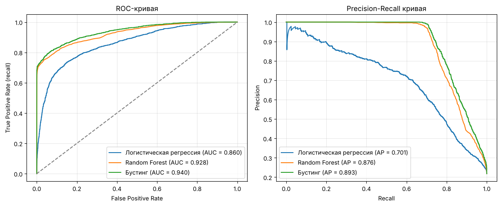
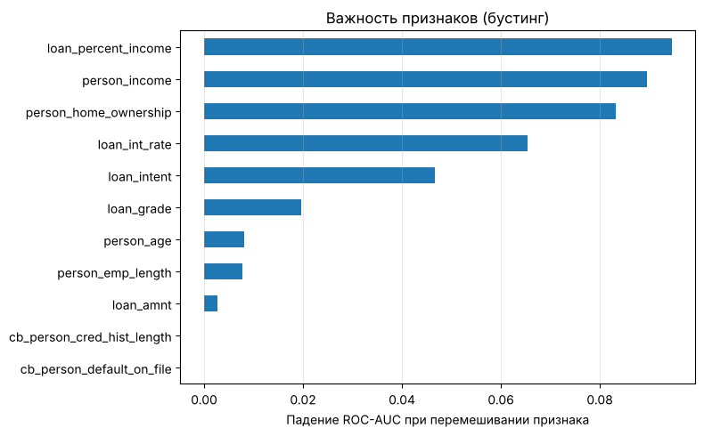

# Кредитный скоринг: предсказание дефолта заемщика

Модель, которая по данным заемщика и кредита оценивает вероятность дефолта. Полный цикл: EDA, очистка данных, сравнение трех моделей, выбор порога классификации под бизнес-задачу и интерпретация признаков.


📓 [Открыть ноутбук в nbviewer](https://nbviewer.org/github/Anastasiien/credit_risk/blob/main/credit_risk.ipynb)

## Результаты

| Модель | ROC-AUC | PR-AUC | Precision | Recall | F1 |
|---|---|---|---|---|---|
| Логистическая регрессия | 0.860 | 0.701 | 0.543 | 0.753 | 0.631 |
| Random Forest | 0.928 | 0.876 | 0.892 | 0.732 | 0.804 |
| **Градиентный бустинг** | **0.940** | **0.893** | **0.968** | 0.714 | **0.822** |

Precision, recall и F1 даны для класса «дефолт» при пороге 0.5 на отложенной выборке (25%, 8144 заемщика).



- Лучшая модель - градиентный бустинг: когда он предсказывает дефолт, он прав в 97% случаев, и находит 71% всех дефолтов.
- Логистическая регрессия сильно отстает (PR-AUC 0.70 против 0.89): зависимость дефолта от признаков нелинейная.

## Выбор порога

Порог «выдать / отказать» - бизнес-решение: пропущенный дефолт стоит банку всей суммы кредита, а лишний отказ - только упущенных процентов. Порог подбирался на кросс-валидации по train, test для этого не использовался.

| Порог | Precision | Recall | Доля отказов |
|---|---|---|---|
| 0.2 | 0.770 | 0.818 | 23.2% |
| 0.3 | 0.884 | 0.773 | 19.1% |
| 0.5 | 0.965 | 0.729 | 16.5% |

Порог 0.5 подходит банку, который не хочет терять клиентов. Порог 0.2-0.3 ловит на 4-9 п.п. больше дефолтов ценой большего числа отказов.

## Какие признаки важны



Главные факторы риска - доля платежа в доходе, доход, тип владения жильем и процентная ставка. Кредитный рейтинг оказался менее важным, чем ожидалось по EDA: его информация уже содержится в процентной ставке, которая назначается по рейтингу.

## Данные

[Credit Risk Dataset](https://www.kaggle.com/datasets/laotse/credit-risk-dataset) с Kaggle: 32 581 заемщик, 11 признаков (возраст, доход, стаж, жилье, цель и сумма кредита, ставка, кредитный рейтинг, кредитная история). Дефолтов 22% - классы несбалансированы.

## Что сделано

1. **EDA:** распределения признаков, выбросы (возраст 144 года, стаж 123 года), связь каждого признака с дефолтом.
2. **Пропуски:** ставка заполнена средним по кредитному рейтингу, стаж - средним по возрастной группе. Средние считаются только по train, чтобы не было утечки данных в test.
3. **Предобработка:** `ColumnTransformer` с `OneHotEncoder` для категориальных и `MinMaxScaler` для числовых признаков.
4. **Модели:** логистическая регрессия → Random Forest с `GridSearchCV` → `HistGradientBoostingClassifier`.
5. **Оценка:** ROC-AUC и PR-AUC (не зависят от порога), затем выбор порога по кросс-валидации.
6. **Интерпретация:** permutation importance на уровне исходных признаков.
7. **Сохранение:** пайплайн (предобработка + модель) и порог в одном файле `model.pkl`.

## Запуск

```bash
git clone https://github.com/Anastasiien/credit_risk.git
cd credit_risk
pip install -r requirements.txt
jupyter notebook credit_risk.ipynb
```

## Структура

```
├── images/
│   ├── roc_pr_curves.png
│   └── feature_importance.png
├── credit_risk.ipynb
├── credit_risk_dataset.csv
├── requirements.txt
└── README.md
```

## Что дальше

- CatBoost / LightGBM и подбор гиперпараметров бустинга
- Порог с учетом реальной стоимости ошибок (сумма кредита, маржа)
- Telegram-бот для оценки заявки

---

**Автор:** Анастасия Бердюгина, НИУ ВШЭ Нижний Новгород
